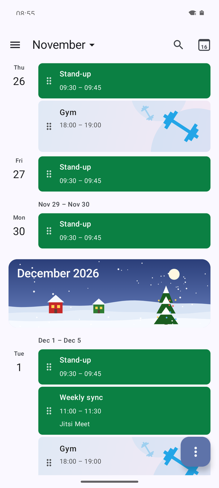
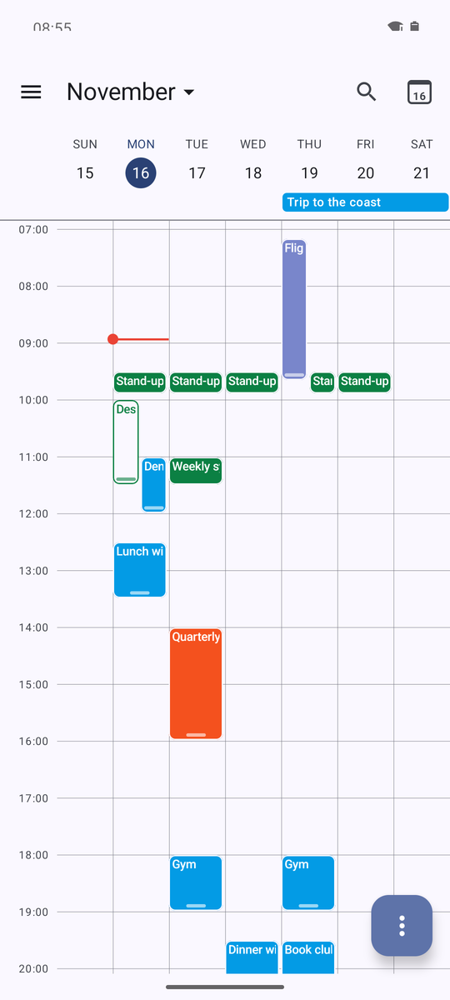
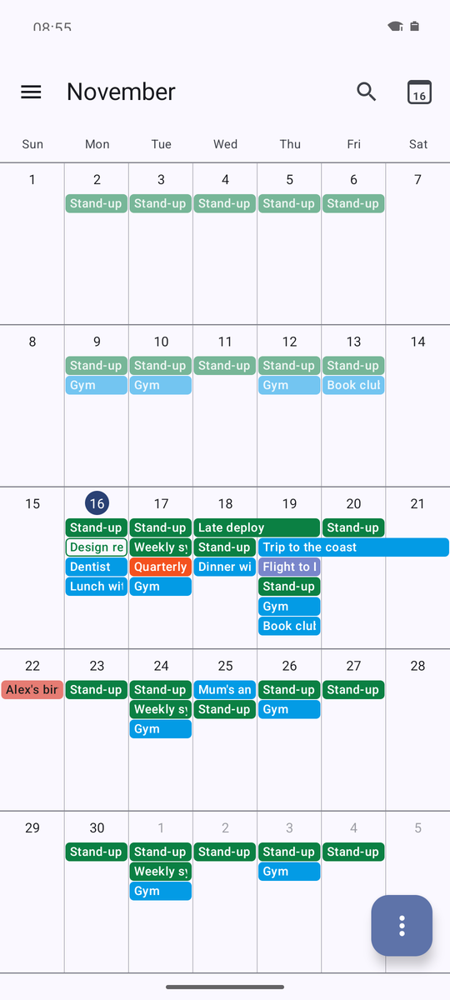
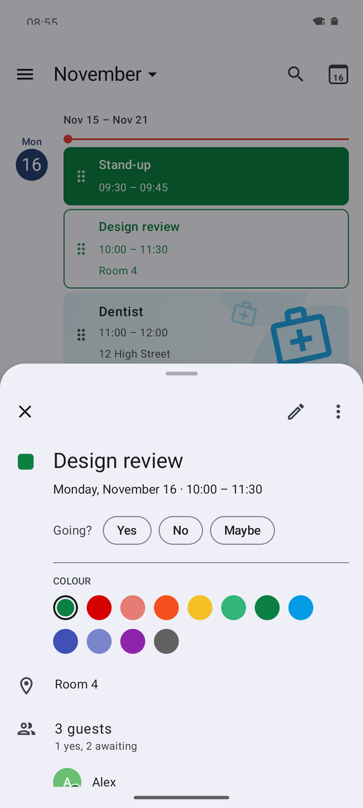
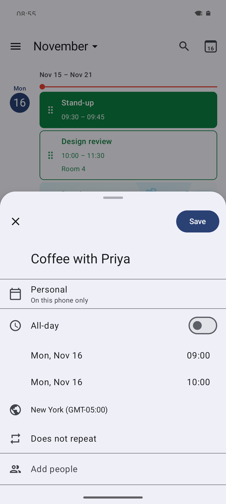
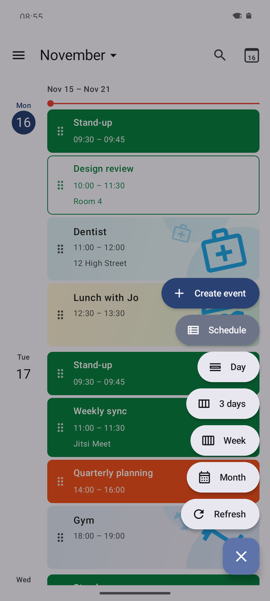
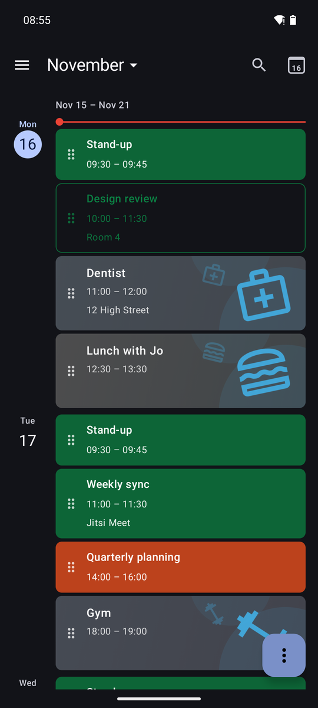

# Almanac

A calendar app for Android that works like the Google Calendar app, without
a Google account. Almanac shows and edits the calendars already on the phone.
Point DAVx5 at a CalDAV server (Davit, Radicale, Nextcloud…)
and your server's calendars appear here, with changes synced back. Nothing
leaves the phone except through your own sync app.

## Features

| | |
|---|---|
| **Views** | Schedule (illustrated months, picture cards for dinners, birthdays, flights…), Day, 3 days, Week and Month; swipe between periods, pinch to zoom, tap a free slot to add an event |
| **Events** | Title, all-day, start/end, time zone, repeat (presets and custom rules), guests with contact suggestions, location, notifications, color, description, busy/free, visibility |
| **Quick edits** | Drag events to a new time or day (in every view), drag the bottom edge to change the length, drag on empty time to create; swipe right to delete (with Undo); press and hold for a menu |
| **One-handed** | A ⋮ menu above the thumb for creating events and switching views; toolbar at the bottom if you like; search, events and the editor open as cards |
| **Repeating events** | Change or delete *this event*, *this and following* or *all events* |
| **Invitations** | Guest list with replies; answer Yes / No / Maybe; email guests; Join button for video calls |
| **Reminders** | Notifications with Snooze, Dismiss and Map; default reminders for timed and all-day events |
| **Find** | Search across all calendars; mini month under the title; Today button |
| **Calendars** | Show/hide and recolor per calendar, Google's 11 event colors, phone-only calendars, birthdays from contacts |
| **Other apps** | Opens "Add to calendar" requests, event links and `.ics` files |
| **Home screen** | Schedule and month widgets |
| **Look** | Material 3 in Google Calendar's style, light/dark, Material You colors |

## Screenshots

| Week | Month | Event | New event |
|---|---|---|---|
|  |  |  |  |

| ⋮ menu | Dark |
|---|---|
|  |  |

## Install

Download `almanac-0.1.0.apk` from the [latest release](https://github.com/crome1394/almanac-android/releases/latest)
and open it on your phone (allow installing from your browser or file
manager when asked), or build it yourself.

## Quick start

1. Install DAVx5 and add your CalDAV account; tick the calendars under **CalDAV**
   ([details](docs/sync.md)).
2. Install Almanac and allow calendar access.
3. In DAVx5's account settings, turn on **Event colors** so events can take
   their own colors.
4. Optional: turn off notifications in any other calendar app, so reminders
   are not shown twice.

Build it yourself with `./gradlew assembleDebug` ([building](docs/building.md)).

## Documentation

| Document | What's in it |
|---|---|
| [docs/sync.md](docs/sync.md) | Connecting a CalDAV server with DAVx5, and what syncs |
| [docs/features.md](docs/features.md) | Every screen and setting, and how it compares with Google Calendar |
| [docs/building.md](docs/building.md) | Building, testing, signing and releasing |
| [ARCHITECTURE.md](ARCHITECTURE.md) | How the app is put together |
| [CHANGELOG.md](CHANGELOG.md) | Changes by version |
| [AGENTS.md](AGENTS.md) | Rules for anyone (or any AI agent) changing the code |

## Privacy

Almanac has no network access at all; the `INTERNET` permission is not
requested. It reads and writes the phone's calendar store, reads contacts only
for birthdays and guest suggestions (both optional), and keeps its settings on
the phone.

## License

[MIT](LICENSE). Not affiliated with Google; "Google Calendar" is named only to
describe the behaviour Almanac follows.
